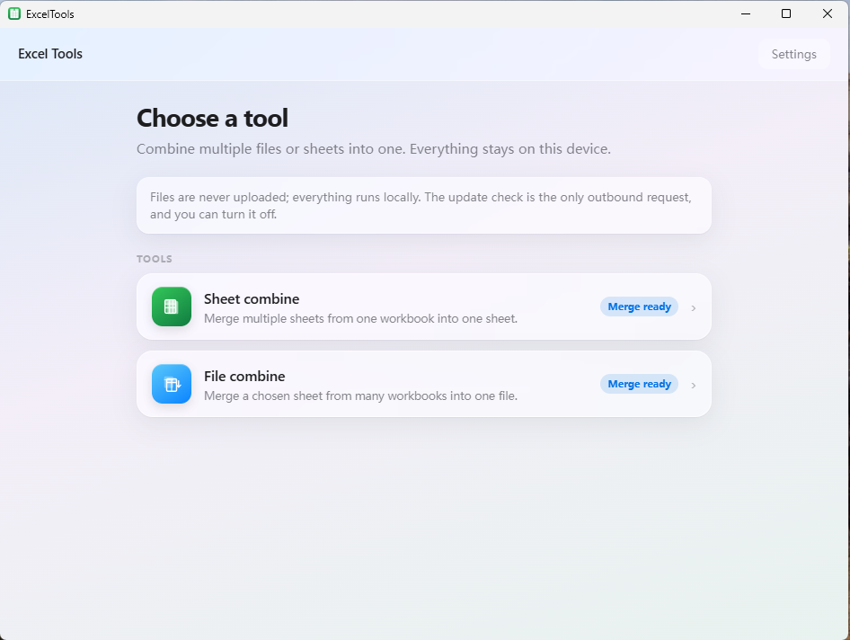

<div align="center">

# 📊 ExcelTools

**A local-first Excel desktop toolkit that merges many files and sheets in a few clicks — and never modifies your source files.**

[](https://github.com/2mf-hermes/ExcelTools/releases)
[](LICENSE)
[](https://go.dev/)
[](https://react.dev/)
[](https://wails.io/)
[](#getting-started)
[](#contributing)

[繁體中文](README.md) ｜ [简体中文](README.zh-CN.md) ｜ **English**

</div>

---

## 📖 What is it

ExcelTools is a **local-first, offline-capable** Excel desktop app: a Go engine with a React UI, packaged with Wails v2. It turns the tedious job of stitching spreadsheets together into a few clicks — and it **never alters your original files**.

## 🎬 Screenshots

<div align="center">


<br/>
<sub>Main window: tool home and version info</sub>

<br/><br/>


<br/>
<sub>File combine: one shared rule plus per-file sheet overrides</sub>

</div>

## ✨ Features

- 🧩 **Sheet combine** — merge multiple sheets from one workbook into a single sheet.
- 🗂️ **File combine** — merge the right sheet from many files: one rule for all (auto-detect, skipping blank sheets, or the Nth sheet), or a specific sheet per file, with automatic column alignment.
- 🔒 **Sources never modified** — everything runs locally; originals stay untouched.
- 🌐 **5 languages** — zh-TW, zh-CN, English, 日本語, 한국어.
- 🎨 **3 themes** — light / dark / system.
- 📴 **Offline-capable** — your files are never uploaded; everything runs locally.
- 🔄 **Auto-update** — checks GitHub Releases at launch and installs only after you confirm, with SHA-256 verification; the previous version's backup is cleaned up automatically, no second restart needed.

## 🔒 Privacy & Network

| Behaviour | Detail |
|-----------|--------|
| Your files | **Never leave your machine.** Merging and file I/O all happen on your computer; nothing is uploaded. |
| The only outbound request | The **update check** at startup (`api.github.com`) plus the update download you explicitly confirm. You can disable the check in **Settings → Check for updates at startup**. |
| When offline | The update check **fails silently** — no error dialog, no impact on features. |
| Update safety | HTTPS only, restricted to this project's GitHub hosts; every redirect hop is validated; the download must match the published SHA-256 or installation is aborted; no elevation, no shell commands, no background processes. |
| Telemetry | **None.** No analytics, no CDN, no remote configuration. |

## 🚀 Getting Started

### Requirements

| Tool | Version |
|------|---------|
| [Go](https://go.dev/) | 1.25+ |
| [Node.js](https://nodejs.org/) | 20+ |
| [Wails CLI](https://wails.io/docs/gettingstarted/installation) | v2 |
| NSIS (optional, for the installer) | latest |

### Install & Build

```powershell
# 1. Get the source
git clone https://github.com/2mf-hermes/ExcelTools.git
cd ExcelTools

# 2. Install the Wails CLI (if not already present)
go install github.com/wailsapp/wails/v2/cmd/wails@latest

# 3. Development mode with hot reload
wails dev
```

## 💡 Usage

```powershell
# Build the portable executable (runs tests first)
powershell -File scripts/package-windows.ps1

# Manual portable build
wails build

# Windows installer (requires NSIS)
wails build -nsis
```

The portable build lands in `dist/`; double-click `ExcelTools.exe` — no installation required. Settings live in `%AppData%\ExcelTools\settings.json`.

### Tests

```powershell
go test ./...
cd frontend; npm run test:i18n
```

## 🗂️ Project structure

```
core/merge/sheets|files   merge engine (sheets / files)
core/report | validate    report and validation logic
core/update               update check, download and install
frontend/src              React UI and i18n
platform/                 filesystem and Excel platform layer
docs/                     DECISIONS, BEHAVIOR_SPEC, DESIGN_TOKENS, RELEASE_CHECKLIST
scripts/                  package-windows.ps1, icon generator
```

## 🤝 Contributing

PRs are welcome:

1. Fork the repo and create a branch: `git checkout -b feature/your-feature`
2. Run the tests before committing: `go test ./...`
3. Open a pull request describing the change and how it was tested.

See [`docs/RELEASE_CHECKLIST.md`](docs/RELEASE_CHECKLIST.md) for the release process.

## 📄 License

Licensed under the [MIT License](LICENSE) — free to use, modify and distribute.
