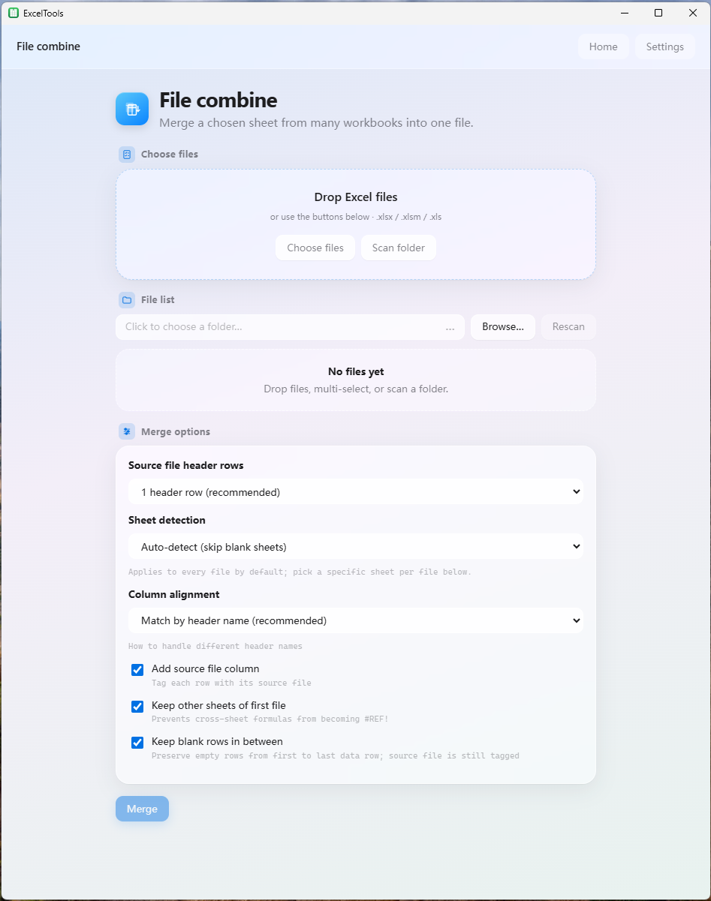

<div align="center">

# 📊 ExcelTools

ExcelTools combines Excel sheets on Windows. Merging works offline and leaves the original files unchanged.

[](https://github.com/2mf-hermes/ExcelTools/releases)
[](LICENSE)
[](https://go.dev/)
[](https://react.dev/)
[](https://wails.io/)
[](#getting-started)

[繁體中文](README.md) ｜ [简体中文](README.zh-CN.md) ｜ [English](README.en.md)

</div>

## Features

- **Sheet combine** — combine several sheets from one workbook into one sheet.
- **File combine** — select a sheet from each workbook and match columns by header or position.
- **Sheet selection** — choose a sheet per file, or use one rule for all files: skip blank sheets automatically or use the Nth sheet.
- **Five languages** — 繁體中文, 简体中文, English, 日本語, and 한국어.
- **Three themes** — light, dark, and system.

Say you have a workbook for each month and want one table with all the sales data. Add the workbooks in File Combine. If Sales is the second tab in most files, choose sheet 2 as the default and pick the Sales tab separately in any file that uses a different order.

## Screenshots

<div align="center">

<br/><sub>Tool home</sub>

<br/><br/>


<br/><sub>File combine: one shared rule or a sheet selected per file</sub>
</div>

## Privacy and update connections

| Item | Details |
|------|---------|
| Excel files | Read and written locally. Files are not uploaded, and source files are not overwritten. |
| Update check | Queries the latest Release from `api.github.com` at startup; you can turn this off in Settings. |
| Update download | Starts only after you confirm, then checks the SHA-256 digest published with the Release. |
| Connection security | Update requests use HTTPS; URLs and redirect hosts are checked at each hop. |
| Telemetry | None. The app does not collect analytics or use remote configuration or a CDN. |

If you start the app offline, the update check fails without an error dialog. You can still merge files. After you confirm an update, the app verifies the download and restarts. It skips automatic installation if the SHA-256 digest is missing or does not match. If the previous version’s `.old` backup is still locked after restart, the app retries deletion every 500 ms for up to 15 seconds.

## Getting started

### Use a release build

Download the Windows portable build from [Releases](https://github.com/2mf-hermes/ExcelTools/releases), extract it, and run `ExcelTools.exe`. No installation is required. Settings are stored in `%AppData%\ExcelTools\settings.json`.

### Run from source

Requirements: Go 1.25.0 or later, Node.js 20.19+ (20.x) or 22.12+, and Wails CLI v2. NSIS 3.x is also required to build an NSIS installer.

```powershell
git clone https://github.com/2mf-hermes/ExcelTools.git
cd ExcelTools
go install github.com/wailsapp/wails/v2/cmd/wails@latest
wails dev
```

### Build and test

```powershell
# Run Go tests, check i18n keys, and create the portable zip
powershell -File scripts/package-windows.ps1

# Build directly
wails build

# Build an installer when NSIS is available
wails build -nsis

# Test
go test ./...
cd frontend; npm run test:i18n
```

`wails build` writes the executable to `build/bin/ExcelTools.exe`. The packaging script puts the portable ZIP in `dist/`. Neither output directory is tracked in Git.

## Project structure

```text
core/merge/       sheet and multi-file merge logic
core/update/      update checks, downloads, verification, and install
frontend/src/     React UI and localization
platform/         filesystem and platform layer
docs/             decisions, behavior specs, design, and release checklist
scripts/          Windows packaging scripts
```

## Contributing

Issues and pull requests are welcome. Run the tests above before opening a pull request, and describe what changed and how you checked it.

See [`docs/RELEASE_CHECKLIST.md`](docs/RELEASE_CHECKLIST.md) for the release process.

## License

[MIT License](LICENSE)
