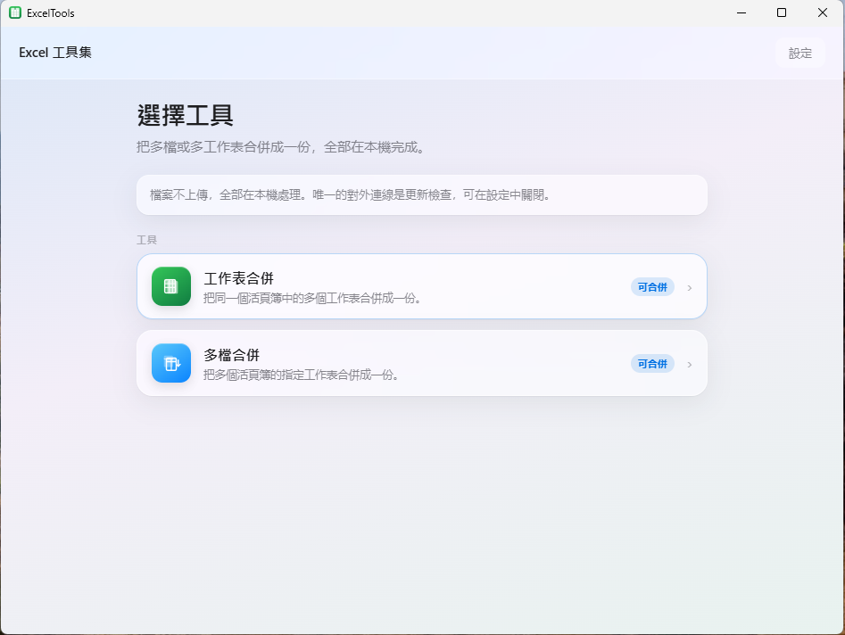

<div align="center">

# 📊 ExcelTools

ExcelTools 在 Windows 上合併 Excel 工作表。合併不需連網，也不會修改來源檔案。

[](https://github.com/2mf-hermes/ExcelTools/releases)
[](LICENSE)
[](https://go.dev/)
[](https://react.dev/)
[](https://wails.io/)
[](#快速上手)

[繁體中文](README.md) ｜ [简体中文](README.zh-CN.md) ｜ [English](README.en.md)

</div>

## 功能

- **工作表合併**：將同一個活頁簿中的多個工作表合併成一張表。
- **多檔合併**：從多個活頁簿選取要合併的工作表，可依欄位標題或位置對齊。
- **工作表選擇**：可為每個檔案單獨指定工作表，也可套用統一規則：自動跳過空白工作表，或選擇第 N 個工作表。
- **五種語言**：繁體中文、簡體中文、English、日本語、한국어。
- **三種外觀**：淺色、深色、跟隨系統。

例如，每月有一份活頁簿，要把各檔的「銷售」工作表彙整成一張表：在「多檔合併」加入檔案。若「銷售」都在第二張，就統一選第 2 個工作表；位置不同的檔案，再逐一指定。

## 展示畫面

<div align="center">

<br/><sub>工具首頁</sub>

<br/><br/>


<br/><sub>多檔合併：統一規則與逐檔工作表選擇</sub>
</div>

## 隱私與更新連線

| 項目 | 說明 |
|------|------|
| Excel 檔案 | 在本機讀取與寫入，不會上傳。來源檔案不會被覆寫。 |
| 更新檢查 | 啟動時向 `api.github.com` 查詢最新 Release；可在設定中關閉。 |
| 更新下載 | 只有在使用者確認後才下載，並比對 Release 提供的 SHA-256。 |
| 連線安全 | 更新請求限 HTTPS，網址與重新導向主機會逐次檢查。 |
| 遙測 | 不收集分析資料，也沒有遠端設定或 CDN。 |

離線時，啟動檢查失敗不會跳出錯誤，也不影響合併。確認安裝後，程式會驗證下載檔並重新啟動；找不到 SHA-256 或驗證不符時不會自動安裝。若重啟時舊版備份（`.old`）仍被占用，程式會在背景每 500 毫秒重試清除，最多 15 秒。

## 快速上手

### 使用已發布版本

從 [Releases](https://github.com/2mf-hermes/ExcelTools/releases) 下載 Windows 可攜版，解壓縮後直接執行 `ExcelTools.exe`，不需要安裝。設定檔位於 `%AppData%\ExcelTools\settings.json`。

### 從原始碼執行

需求：Go 1.25.0 以上、Node.js 20.19+（20.x）或 22.12+、Wails CLI v2。若要產生 NSIS 安裝檔，另需 NSIS 3.x。

```powershell
git clone https://github.com/2mf-hermes/ExcelTools.git
cd ExcelTools
go install github.com/wailsapp/wails/v2/cmd/wails@latest
wails dev
```

### 建置與測試

```powershell
# 執行 Go 測試、i18n 檢查並建立可攜版 zip
powershell -File scripts/package-windows.ps1

# 單獨建置
wails build

# 需要 NSIS 時建立安裝檔
wails build -nsis

# 測試
go test ./...
cd frontend; npm run test:i18n
```

`wails build` 將執行檔放在 `build/bin/ExcelTools.exe`。打包腳本將可攜版 ZIP 放在 `dist/`；兩個輸出目錄都不納入版本控制。

## 專案結構

```text
core/merge/       工作表與多檔合併邏輯
core/update/      更新檢查、下載、驗證與安裝
frontend/src/     React 介面與多語系
platform/         檔案系統與平台層
docs/             決策、行為規格、設計與發布清單
scripts/          Windows 打包腳本
```

## 貢獻

歡迎回報問題或提出 Pull Request。送出 PR 前，請執行上方測試，並在說明中寫下改了什麼、怎麼驗證。發布流程請參考 [`docs/RELEASE_CHECKLIST.md`](docs/RELEASE_CHECKLIST.md)。

## 授權

本專案採用 [MIT License](LICENSE)。
