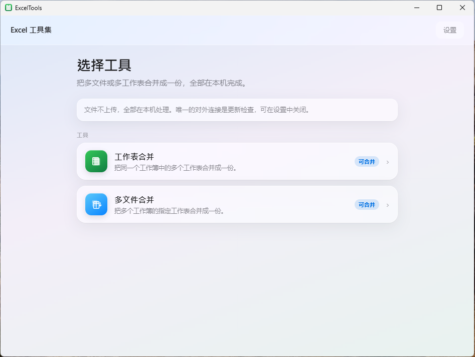

<div align="center">

# 📊 ExcelTools

**本地优先的 Excel 桌面工具集，多文件、多工作表合并一键完成，源文件绝不被修改。**

[](https://github.com/2mf-hermes/ExcelTools/releases)
[](LICENSE)
[](https://go.dev/)
[](https://react.dev/)
[](https://wails.io/)
[](#快速上手)
[](#贡献指南)

[繁體中文](README.md) ｜ **简体中文** ｜ [English](README.en.md)

</div>

---

## 📖 这是什么

ExcelTools 是一套**本地优先、离线可用**的 Excel 桌面工具，使用 Wails v2 打包 Go 引擎与 React 界面。它把日常最恼人的「把一堆表格拼在一起」变成几次点击——而且**永远不会改动你的原始文件**。

## 🎬 展示画面

<div align="center">


<br/>
<sub>主界面：工具首页与版本信息</sub>

<br/><br/>


<br/>
<sub>多文件合并：统一规则 + 逐一指定各文件的工作表</sub>

</div>

## ✨ 主要特性

- 🧩 **工作表合并** — 把单一工作簿里的多个工作表合并成一张。
- 🗂️ **文件合并** — 合并多个工作表的指定内容：统一取「自动判断（跳过空白工作表）」或第 N 个工作表，也可逐一指定每个文件要使用哪个工作表；并自动对齐列位。
- 🔒 **源文件零修改** — 所有处理都在本机完成，原始文件原封不动。
- 🌐 **五种语言** — 繁體中文、简体中文、English、日本語、한국어。
- 🎨 **三种主题** — 浅色 / 深色 / 跟随系统。
- 📴 **离线可用** — 文件不上传，全部在本机处理。
- 🔄 **自动更新** — 启动时检查 GitHub Releases；经你确认后才下载安装，并以 SHA-256 验证文件；更新后自动清除旧版备份，无需再次重启。

## 🔒 隐私与网络

| 行为 | 说明 |
|------|------|
| 你的文件 | **永不离开本机**。合并、读写全部在电脑上完成，没有任何上传。 |
| 唯一的对外连接 | 启动时的**更新检查**（`api.github.com`），以及你按下「下载并安装」后的更新下载。可在 **设置 → 启动时自动检查更新** 关闭。 |
| 离线时 | 更新检查会**静默失败**，不会弹出错误、不影响功能。 |
| 更新安全 | 仅允许 HTTPS 与本项目 GitHub 域名；重定向逐跳验证；下载后比对官方 SHA-256，**不符即中止不安装**；不要求管理员权限、不调用外部命令、不常驻后台程序。 |
| 遥测 | **无**。没有分析、没有 CDN、没有远程配置。 |

> 早期版本 README 写「完全不联网」。新增更新功能后这句话不再成立，因此在此明确改写，而非默默略过。

## 🚀 快速上手

### 前置需求

| 工具 | 版本 |
|------|------|
| [Go](https://go.dev/) | 1.25+ |
| [Node.js](https://nodejs.org/) | 20+ |
| [Wails CLI](https://wails.io/docs/gettingstarted/installation) | v2 |
| NSIS（可选，用于生成安装包） | 最新版 |

### 安装与构建

```powershell
# 1. 获取源码
git clone https://github.com/2mf-hermes/ExcelTools.git
cd ExcelTools

# 2. 安装 Wails CLI（若尚未安装）
go install github.com/wailsapp/wails/v2/cmd/wails@latest

# 3. 开发模式（热重载）
wails dev
```

## 💡 使用示例

```powershell
# 生成便携版可执行文件（含测试）
powershell -File scripts/package-windows.ps1

# 手动构建便携版
wails build

# 生成 Windows 安装包（需 NSIS）
wails build -nsis
```

构建完成后，便携版可执行文件位于 `dist/`，直接双击 `ExcelTools.exe` 即可使用，无需安装。配置文件存放于 `%AppData%\ExcelTools\settings.json`。

### 运行测试

```powershell
go test ./...
cd frontend; npm run test:i18n
```

## 🗂️ 项目结构

```
core/merge/sheets|files   合并引擎（工作表 / 文件）
core/report | validate    报表与验证逻辑
core/update               更新检查、下载与安装
frontend/src              React UI 与 i18n
platform/                 文件系统与 Excel 平台层
docs/                     DECISIONS、BEHAVIOR_SPEC、DESIGN_TOKENS、RELEASE_CHECKLIST
scripts/                  package-windows.ps1、图标生成器
```

## 🤝 贡献指南

欢迎参与！流程如下：

1. Fork 本项目并建立分支：`git checkout -b feature/your-feature`
2. 提交变更前先跑过测试：`go test ./...`
3. 提交 Pull Request，并在描述中说明变更内容与测试方式。

发布流程细节请见 [`docs/RELEASE_CHECKLIST.md`](docs/RELEASE_CHECKLIST.md)。

## 📄 许可证

本项目采用 [MIT License](LICENSE) 许可，可自由使用、修改与分发。
